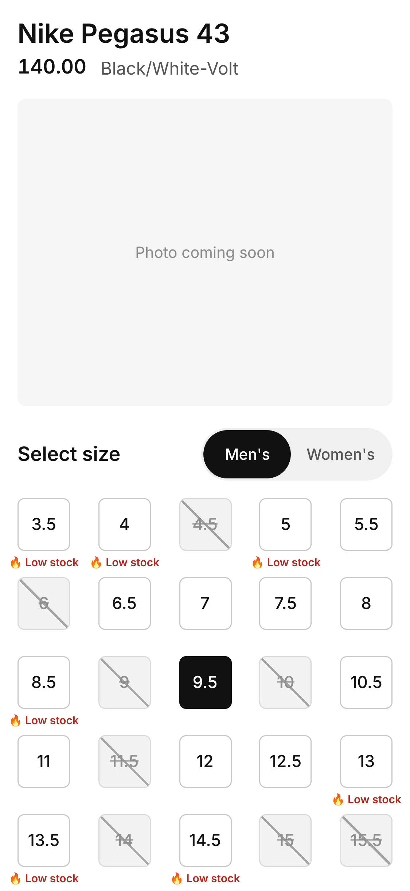

**Live page: https://nikesize-bhawana5.vercel.app/**

# Nike Pegasus 43 — mobile product page

A Next.js (App Router) product page for the Nike Pegasus 43, built for a 375px-wide phone.
The shoe name, price, colourway and all 26 sizes are read from
[`data/nike_pegasus_size_stock.json`](data/nike_pegasus_size_stock.json) at build time. That file now holds the
**Pegasus Size and Stock Snapshot of 8 December 2026**, replacing the older 16 November list.

**Hosting:** deployed on Vercel from this repo; every push to `main` redeploys. After each production deploy, a GitHub
Action ([`lighthouse.yml`](.github/workflows/lighthouse.yml)) runs Lighthouse on the live vercel.app URL and commits
the report to [`lighthouse/`](lighthouse/) ([summary](lighthouse/summary.md)). Commits that only change `lighthouse/`
don't trigger a new deploy ([`vercel.json`](vercel.json)).

**Speed and layout shift:** [`speed-budget.json`](speed-budget.json) sets the launch-check budget. It requires a
score of at least 90, 0px of size-grid movement, and size buttons of at least 48px. The Slow 4G trace findings, every
layout fix (fixed photo box, fixed price height) and the prompts used are in [`PERFORMANCE.md`](PERFORMANCE.md).

## View it at phone width

```bash
npm install
npm run dev
```

1. Open <http://localhost:3000> in Chrome.
2. Open DevTools (`Cmd+Option+I` on Mac, `Ctrl+Shift+I` on Windows/Linux).
3. Turn on the device toolbar (`Cmd+Shift+M` / `Ctrl+Shift+M`).
4. Choose **iPhone SE** (375 × 667), or pick **Responsive** and set the width to **375**.
5. Reload the page so the mobile viewport settings apply.

To see it on a real phone, run `npm run dev -- -H 0.0.0.0` and open `http://<your-computer's-IP>:3000`
on a phone on the same Wi-Fi network.

## What's where

| Path | What it does |
| --- | --- |
| `data/nike_pegasus_size_stock.json` | The size and stock list. The only source of product data |
| `lib/product.ts` | Reads the file, sorts sizes by `display_order`, and fails the build if name, price or colourway differ between rows |
| `app/page.tsx` | Page order: name, price and colourway → main photo area → size grid |
| `components/SizePicker.tsx` | Men's/Women's toggle and the 26-button size grid |
| `app/layout.tsx` | Viewport: device width, pinch-zoom off |

## Test IDs

| `data-testid` | Element |
| --- | --- |
| `product-page` | Page wrapper |
| `product-header` | Name, price and colourway block |
| `product-name`, `price`, `product-colorway` | Each value |
| `main-photo` | Main photo area |
| `size-section` | Size picker section |
| `size-system-toggle` | Men's/Women's toggle; options are `size-toggle-men` and `size-toggle-women` |
| `size-grid` | The grid (`data-size-system` = `men` or `women`) |
| `size-cell` | Each grid cell |
| `size-button` | Each in-stock or low-stock size button, with `data-sku`, `data-status` (`in_stock` / `low_stock`), `data-size-men`, `data-size-women` |
| `size-button-sold-out` | Each sold-out size button: disabled, full size, same data attributes, `data-status="sold_out"` |
| `low-stock-tag` | The 🔥 Low stock tag |

## Notes

- Size buttons are 48 × 48px, five to a row. The low-stock tag sits in the gap under its button, so it never changes a button's size.
- Sold-out sizes are greyed out, disabled, and also marked with a diagonal line and struck-through text.
- Pinch-zoom is turned off with the viewport tag and `touch-action`. iOS Safari can still allow zooming because Apple ignores `user-scalable=no`.
- **Fixed photo box (layout-shift fix).** The main photo area is a fixed 280px-tall box, so its space is reserved
  before any photo loads and a late photo can't push the size grid down. It's a placeholder until product photos are
  supplied; real photos should fill the same box with `width`/`height` set.
- **Price keeps its space (layout-shift fix).** The price box has a fixed size: 24px tall with a 24px line height, and at least 64px wide, which fits "140.00". The name/price row is centre-aligned rather than baseline-aligned, because an empty box on a baseline row sits lower and makes the row taller. So if the price text or its font arrives late, nothing above the size grid grows and the grid stays put.
  - Tested on Slow 4G (562.5 ms request delay, 1474.56 Kbps down, 675 Kbps up), 4x CPU slowdown, 375 × 812 at 3x, mobile on.
  - Before the fix, a late price moved the grid down 3px, and so did a late font swap.
  - After the fix, both moved it 0px. A normal load also moved it 0px in 3 out of 3 runs, with no layout shifts recorded. The grid now starts at 454px.

## Vercel deploy notes (8 December snapshot)



*Phone screenshot: 375 × 812 CSS px at 3x, US Men's 9.5 selected. Sold-out sizes are grey with a diagonal line.*

**Sold-out sizes match the snapshot.** The snapshot marks 9 of the 26 sizes `sold_out`, each with `in_stock: false`
and 0 pairs. The page shows exactly those 9 as sold out: each one is a full-size 48 × 48 CSS px button (above the
44 × 44 minimum), grey, disabled, with a diagonal line and struck-through number, and `data-testid="size-button-sold-out"`.
The other 17 sizes stay tappable.

| US Men's | US Women's | EU | SKU | Pairs in snapshot |
| --- | --- | --- | --- | --- |
| 4.5 | 6 | 36.5 | `HV7521-001-045` | 0 |
| 6 | 7.5 | 38.5 | `HV7521-001-060` | 0 |
| 9 | 10.5 | 42.5 | `HV7521-001-090` | 0 |
| 10 | 11.5 | 44 | `HV7521-001-100` | 0 |
| 11.5 | 13 | 45.5 | `HV7521-001-115` | 0 |
| 14 | 15.5 | 48.5 | `HV7521-001-140` | 0 |
| 15 | 16.5 | 49.5 | `HV7521-001-150` | 0 |
| 15.5 | 17 | 50 | `HV7521-001-155` | 0 |
| 16 | 17.5 | 50.5 | `HV7521-001-160` | 0 |

- **What changed from the 16 November list:** size 3.5 is no longer sold out (1 pair, now low stock), and sizes 4.5,
  6, 9, 11.5, 14 and 15 are newly sold out.
- **Low stock:** 7 sizes have 1–5 pairs and get the 🔥 Low stock tag: 3.5, 4, 5, 8.5, 13, 13.5 and 14.5.
- **Checked twice:**
  - `perf/check_page.py` reads the expected sold-out and low-stock sizes from the data file, so it follows the snapshot.
  - The Lighthouse Action compares the live page's sold-out buttons with the file on every deploy, in
    [`lighthouse/summary.md`](lighthouse/summary.md).

**Prompt:**

> Deploy the Pegasus 43 phone page to Vercel. Use the Pegasus Size and Stock Snapshot from 8 December 2026 for all 26 sizes, not the older 16 November list. Show sold_out sizes as full-size grey disabled buttons, at least 44 by 44 CSS pixels. Run Lighthouse in mobile mode (Slow 4G, CPU throttling) on the live vercel.app URL, not localhost, and save the report in the repo. Put the live URL on the first line of the README, commit a phone screenshot with a size selected, and add short notes with this prompt and how the sold-out sizes match the snapshot. Give me the live link when it's done

## Original build prompt

The sold-out and low-stock sizes named in this prompt come from the 16 November list, which the snapshot has replaced.

> Build a Next.js (App Router) page for the Nike Pegasus 43 running shoe, made for a 375 CSS pixel wide phone. No horizontal scroll and no pinch-zoom.
> Read the shoe name, price and all 26 sizes from the Pegasus 43 size and stock list file (nike_pegasus_size_stock.json). Don't type them in by hand. Use display_order for the order.
> Page order: product name, price (140.00) and colorway (Black/White-Volt) once above the size grid, then the main photo area, then the size grid starting on the lower part of the first screen.
> Size grid: all 26 buttons always show, at least 44 by 44 CSS pixels (I want 48 by 48). Default to men's sizes with a toggle to women's, small to big. Sold-out sizes (3.5, 10, 15.5, 16) stay full size, greyed out, disabled, with a second cue besides colour. Low-stock sizes (4, 9, 9.5, 11, 15) get a low stock tag with a fire emoji that doesn't change the button size.
> Add data-testid labels on the page parts. Then create a new GitHub repo with gh, push the code, and add a README with this prompt and a short note on how to view the page at phone width. Give me the repo link at the end
